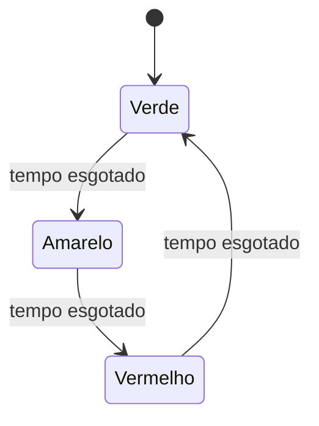
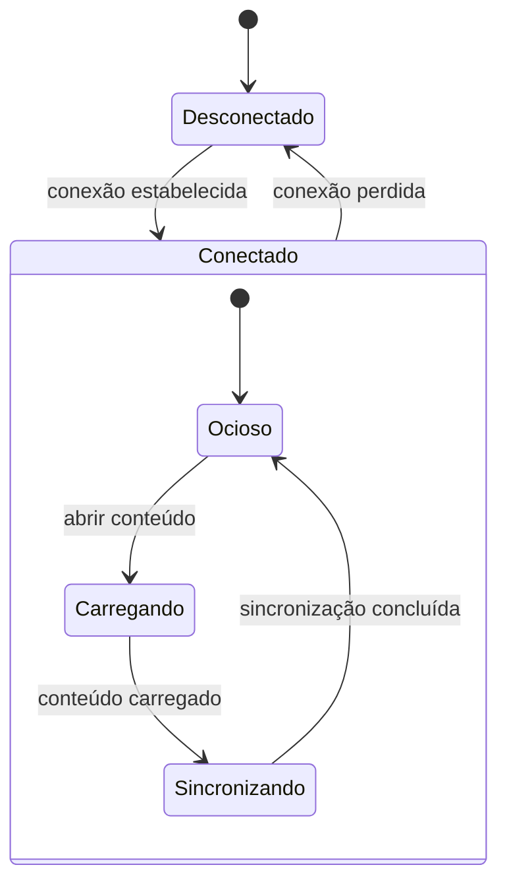
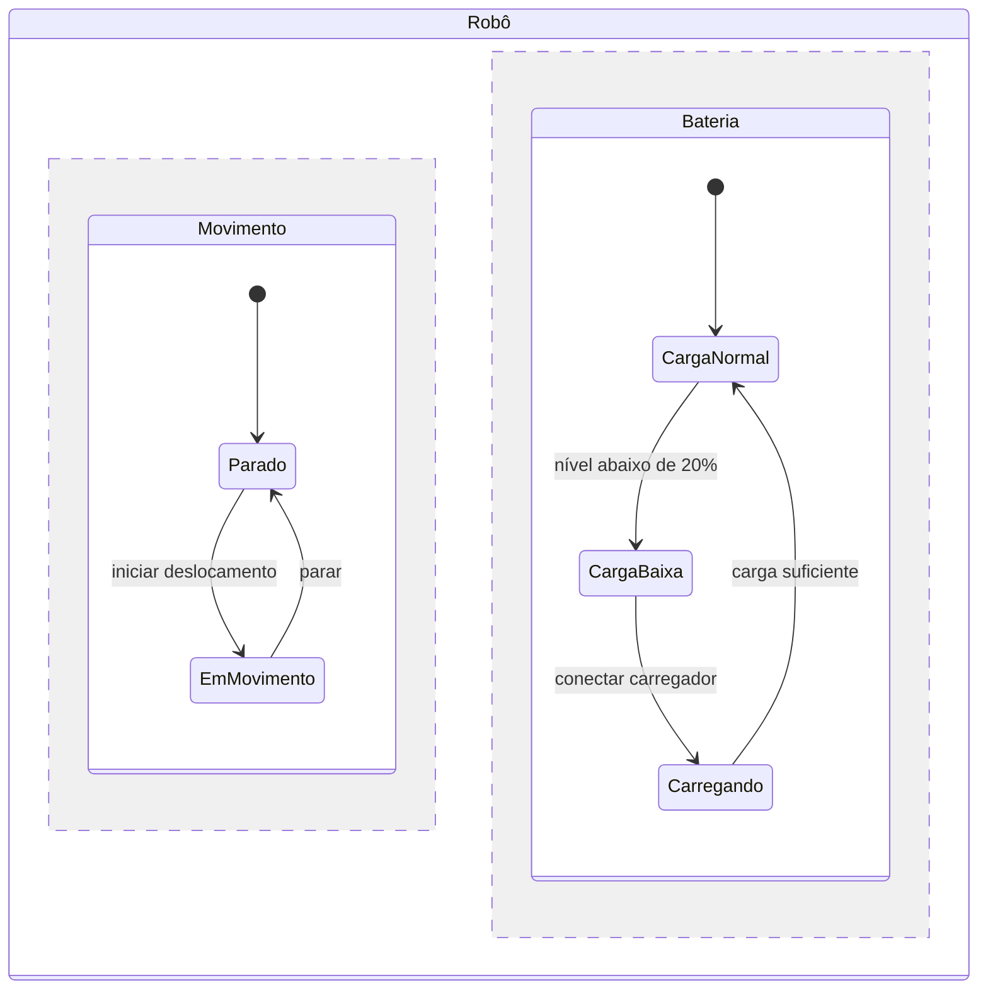
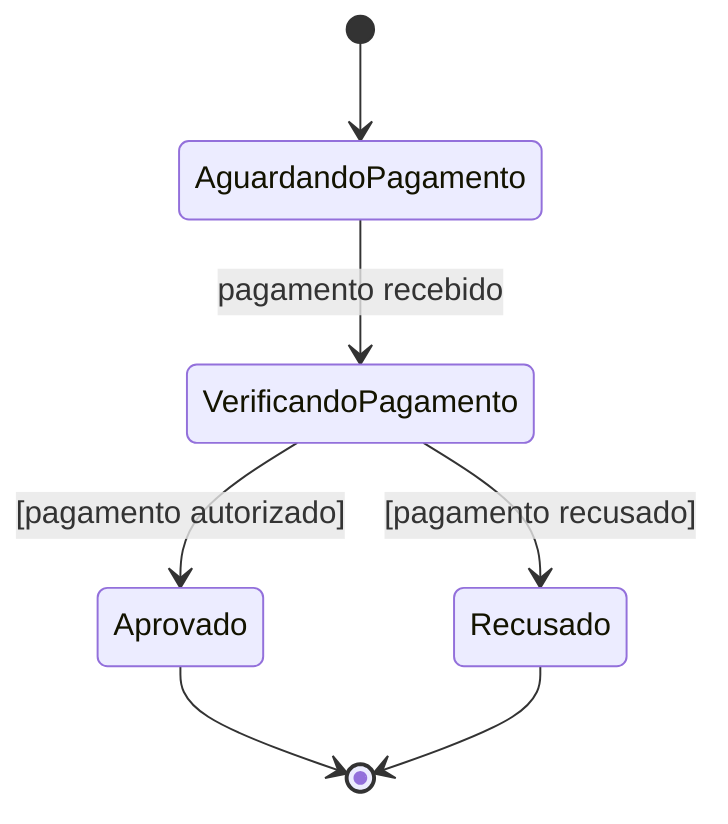
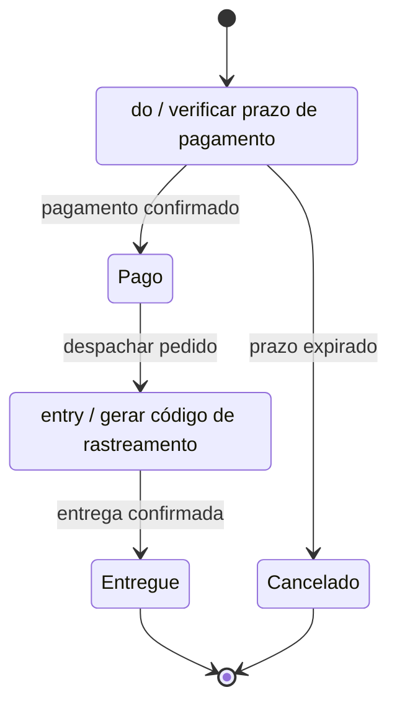
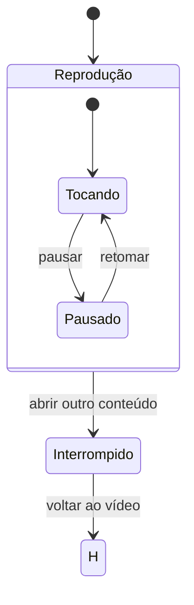
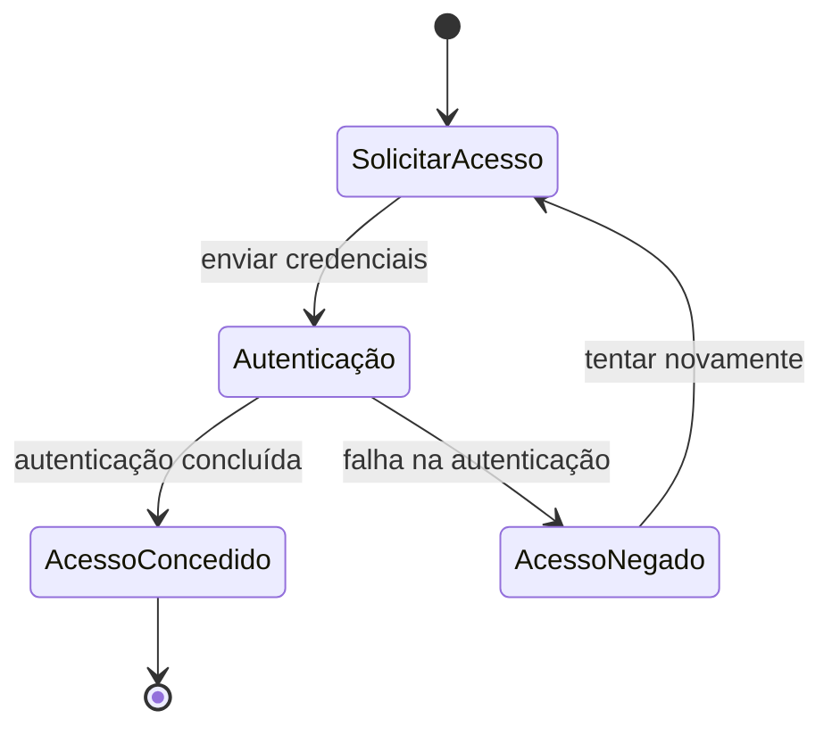
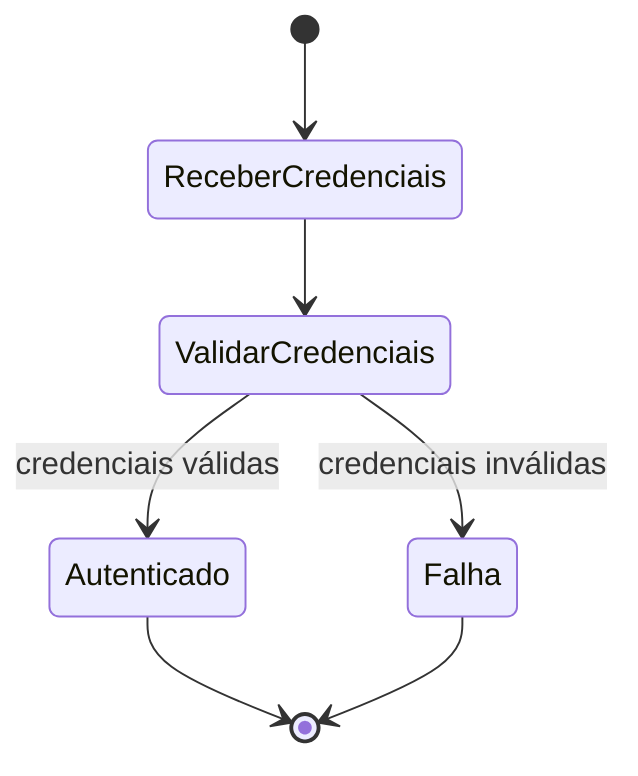

# Diagramas de máquina de estados

 Não há uma lista universal de tipos independentes: a UML define um tipo de diagrama comportamental, que pode ser construído com diferentes estruturas e níveis de complexidade. A tabela abaixo reúne as principais variações e formas de organização [1].

| Nome | Descrição | Exemplo de aplicação prática |
|---|---|---|
| **Máquina de estados finitos (MEF)** | Representa um conjunto definido de estados e as transições entre eles, acionadas por eventos. | Semáforo: **verde → amarelo → vermelho**. |
| **Máquina de estados hierárquica** | Agrupa estados relacionados dentro de um estado composto; ajuda a organizar modelos grandes. | Aplicativo: estado **Conectado** contendo **Ocioso**, **Carregando** e **Sincronizando**. |
| **Máquina de estados concorrente (ortogonal)** | Divide um estado em regiões que podem evoluir simultaneamente. | Robô: controlar ao mesmo tempo o **movimento** e o **nível de bateria**. |
| **Máquina de estados com guardas** | Usa condições para permitir ou bloquear uma transição. | Compra: avançar para **Aprovado** somente se o pagamento for autorizado. |
| **Máquina de estados com ações e atividades** | Associa ações a uma transição ou atividades à permanência em um estado. | Pedido: ao entrar em **Enviado**, gerar código de rastreamento; enquanto **Aguardando pagamento**, verificar prazo. |
| **Máquina de estados com histórico** | Permite retornar ao último subestado ativo de um estado composto após uma interrupção. | Player de vídeo: sair de **Reproduzindo** para **Pausado** e retomar de onde parou. |
| **Máquina de estados com submáquina** | Reutiliza um comportamento de estados definido em outro diagrama ou componente. | Fluxo de autenticação reutilizado em vários serviços: **solicitar credenciais → validar → autenticar**. |

Essas formas podem ser combinadas no mesmo diagrama. Por exemplo, um fluxo de pedido pode usar estados hierárquicos, condições para aprovar o pagamento e ações ao despachar o produto. Diagramas de estados são especialmente úteis para descrever o ciclo de vida de um objeto e como ele reage a eventos [1,2].

Read More
- | Título | Ref
-- | -- | --
[1] | Diagrama de Estados – Um Tutorial Rápido | https://blog.visual-paradigm.com/pt/state-diagram-a-quick-tutorial/
[2] | ¿Qué es un diagrama de máquina de estados? - ProcessOn | https://www.processon.io/es/blog/create-a-state-machine-diagram

## Exemplos

Aqui estão os sete exemplos em Mermaid. Cada bloco representa uma variação de máquina de estados; alguns recursos, como submáquinas reutilizáveis, são representados de forma esquemática porque o Mermaid não oferece uma notação nativa completa para todos os elementos UML.

---
### 1. Máquina de estados finitos — semáforo

---
### 2. Máquina hierárquica — aplicativo conectado

Os estados de carregamento e sincronização ficam agrupados dentro do estado composto `Conectado`.

---
### 3. Máquina concorrente — robô

O robô controla movimento e bateria em regiões distintas, que evoluem em paralelo.

---
### 4. Máquina com guardas — aprovação de compra

A condição entre colchetes determina qual transição pode ocorrer após a resposta do serviço de pagamento.

---
### 5. Máquina com ações e atividades — pedido enviado

As ações `entry` e `do` ilustram uma ação executada ao entrar em um estado e uma atividade realizada enquanto o sistema permanece nele.

---
### 6. Máquina com histórico — player de vídeo

O estado de histórico `H` indica a retomada do estado composto `Reprodução` no subestado anteriormente ativo, como `Tocando` ou `Pausado`.

---
### 7. Máquina com submáquina — autenticação reutilizável

O estado `Autenticação` representa uma submáquina reutilizável. Seu fluxo interno está indicado separadamente para deixar explícita a lógica encapsulada.

Fluxo interno da submáquina `Autenticação`:

